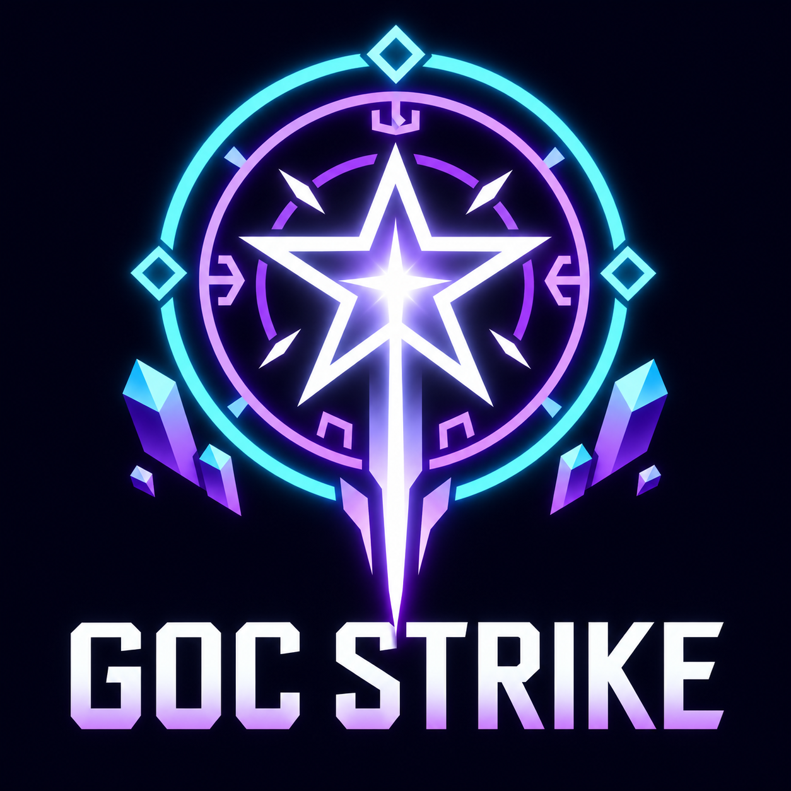

<p align="center">
  
</p>

# 奇术打击

Minecraft **1.21.1 / NeoForge 21.1.265** 模组，需要 Java 21，客户端和服务器均需安装。

## 使用

在创造模式的「工具与实用物品」栏获取「奇术打击」，或执行：

```mcfunction
/give @s gocstrike:thaumaturgic_strike
```

- 右键：以使用位置为固定中心，在头顶展开约 118.7 秒的完整法阵动画。
- 潜行右键：立即收起自己召唤的法阵。
- 每个维度同时播放一场；播放期间再次使用会显示提示。
- 物品可重复使用，不消耗。结束或卸载区块后清理法阵；退出世界不会保存未完成的法阵。

建议在开阔地观看，仰视中央法阵，或退开约 40–70 格观看全景。法阵沿用原效果的 2.4 倍世界比例，主要结构位于使用点上方数十格。

动画保留外围符印、悬浮晶体、逐段反射、分层旋转法阵、汇聚光束、冲击环和末尾白光。客户端在两帧姿态间插值，仅同步一个效果实体。实体笔画使用保留色相的无光照渲染，再由独立发光层经过两级高斯模糊、屏幕混合生成 Bloom 光晕，无需额外模组或光影包。泛光只作用于法阵，不会让整个画面一起泛白；实体遮挡仍参与发光层的深度判断。此效果不放置光源方块，不改变地形，结束或退出世界时释放渲染缓冲。

最终打击在动画约 116.8 秒时执行一次，作用于法阵所在维度中所有已加载的生物。普通生物直接移除，不经过伤害或死亡流程，不产生其死亡掉落和经验；非旁观者玩家先清空背包（含护甲、副手、光标物品及关闭合成界面后返回的材料），再走原生死亡流程，最后断开连接。旁观者玩家完全不受影响，创造模式玩家也在处理范围内。未加载的区块、其他维度、末影箱及容器存储不处理；方块和已有的掉落物不清除。打击前取消法阵会取消这次清除。

不修改时间、天气、玩家视角或移动。包含用户提供的原版《风雪史诗》配乐和参考视频的同步字幕。配乐与动画沿用原插件的统一时间轴，从第 0 秒同时开始，不含视频内的游戏声音。播放时暂停原版背景音乐的选择，结束后恢复原生音乐调度。音乐音量由游戏「音乐」滑块控制；取消、结束或离开世界时停止播放。中途进入可从当前动画时间播放。字幕使用参考视频的十段歌词、希腊字符解码效果和结尾字幕，与法阵共用时间轴。

## 构建

```powershell
./gradlew.bat build
```

产物为 `build/libs/gocstrike-1.0.0.jar`。模型和动画已经打包，正常构建不需要 Blender、Unity 或 GIMP。

## 动画来源与再生成

模型与动画来源于 SCPSL 游戏的[星河梦影](https://qm.qq.com/q/WYYBK75FWc)服务器。

模型和运动编排固定取自 `goc-strike-demo` 的提交：

```text
7f9a7c12f5c6576d129b6c5d7bae5a6336e66a2d
```

参考源文件和可重复生成步骤见 [tools/README.md](tools/README.md)。

## 许可与署名

- 软件代码： [MIT License](LICENSE)。NeoForge MDK 模板原有声明保留在 [TEMPLATE_LICENSE.txt](TEMPLATE_LICENSE.txt)。
- 法阵模型及由模型生成的资源：**All Rights Reserved（ARR，保留所有权利）**，不适用 MIT；具体范围见 [MODEL_LICENSE.txt](MODEL_LICENSE.txt)。
- 音乐：《风雪史诗》，作者：**西蒙Leonardo**。音乐不在本项目 MIT 授权范围内。
