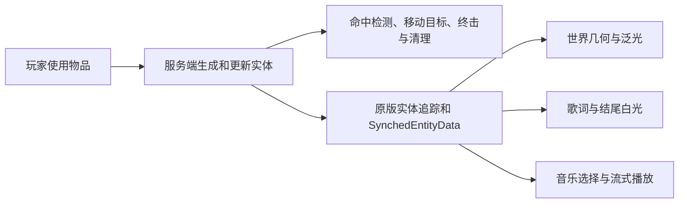

# GOC Strike 实现说明

本文以仓库根项目的 **Minecraft 1.21.1、NeoForge 21.1.265、Java 21** 实现为准。奇术打击与达摩克里斯之剑都由服务端临时实体确定演出位置、时间和结算。客户端根据同步状态播放本地模型、动画和音轨。其他版本可以沿用这些约定，各自适配加载器和渲染接口。

## 注册与职责

两件物品及其实体分别注册为 `gocstrike:thaumaturgic_strike` 和 `gocstrike:damocles_sword`。物品与实体属于不同注册表，可以使用同一个资源 ID。`GOCStrike` 用 `DeferredRegister` 注册它们，并把两件单件堆叠物品加入创造模式的「工具与实用物品」栏。两种实体都属于 `MISC`，配置了 `noSave`、`noSummon` 和免火，无重力地承担演出锚点或飞行剑的职责。物品提示、动作栏消息和断开连接提示使用 `Component.translatable`，语言资源位于 `assets/gocstrike/lang`。演出歌词另存一份带有时间和颜色的数据。 [注册入口](../src/main/java/com/xiaoyu/gocstrike/GOCStrike.java) · [语言资源](../src/main/resources/assets/gocstrike/lang)

玩家使用物品时，客户端返回交互结果，服务端处理实际生成、取消和冷却。物品实现原样返回手中的 `ItemStack`，因此可以重复使用。客户端渲染器和着色器由 `Dist.CLIENT` 的模组事件处理器注册，渲染、HUD 和音频由客户端游戏事件驱动。服务端通过实体更新包传递位置和少量字段，客户端从 JAR 里读取完整的演出资源。 [奇术打击物品](../src/main/java/com/xiaoyu/gocstrike/StrikeItem.java) · [达摩克里斯之剑物品](../src/main/java/com/xiaoyu/gocstrike/DamoclesItem.java) · [客户端注册入口](../src/main/java/com/xiaoyu/gocstrike/client/StrikeRenderer.java)

## 实体同步和两条时间轴

动画时间使用维度的 `gameTime`。客户端把 `gameTime - START + partialTick` 除以 `20` 得到演出秒数，服务端结算使用 `partialTick = 0`。`START = -1` 表示演出尚未开始。客户端中途开始追踪实体时，可以用同步的起始刻数直接计算当前进度。服务端停顿或掉刻会降低按游戏刻推进的演出速度，音轨进入播放后由声音引擎连续解码。

| 实体 | 同步字段 | 字段用途 |
| --- | --- | --- |
| 奇术打击 | `START` | 施放成功时记录的起始刻数。实体生成位置为法阵的固定锚点。 |
| 达摩克里斯之剑 | `START`、`LIFT`、`HEAD`、`CAPTIVE_ID`、`IMPACT_AT` | 分别记录锁定时刻、允许升空的距离、目标碰撞箱高度、目标实体 ID 和服务端实际确认终击的刻数。 |

奇术打击的客户端追踪参数为 32 区块、更新间隔 20 刻，剑为 16 区块、1 刻。剑飞行时需要更频繁的位置更新。渲染还会检查距离和可见性。已锁定的剑若找不到目标客户端实体，会用锁定锚点和缓动升空量计算徽记位置。为了防止客户端插值提前触发命中闪光，剑的视觉时间在 `IMPACT_AT` 同步前限制在 70 秒以下。收到确认后，闪光、停顿、冲击环和解体都从这次确认重新计时。 [奇术打击实体](../src/main/java/com/xiaoyu/gocstrike/StrikeEntity.java) · [达摩克里斯实体](../src/main/java/com/xiaoyu/gocstrike/DamoclesEntity.java)

## 奇术打击的服务端流程

1. `StrikeItem.use` 在当前 `ServerLevel` 中查找活动法阵。每个维度最多一场。普通右键生成实体，记录使用者 UUID 和当时的脚下坐标。潜行右键仅能取消本人召唤的法阵。动作栏提示反映生成、占用或取消结果。
2. 法阵位置在生成时确定，客户端以该位置为原点播放 `118.698667` 秒的动画，世界缩放系数为 `2.4`。使用者之后的移动与演出位置无关。实体随维度正常加载与更新，法阵本身没有额外的区块票据。
3. 演出跨过 `116.782` 秒时执行一次终击。服务端先快照当前维度中已加载、未移除且符合条件的生物，再逐个处理。死亡、断线或其他模组的回调可能改动实体集合，快照可以让这次结算继续完成。处理每个目标前会再次检查移除和旁观者状态，个别目标异常单独记日志。
4. 普通生物直接 `discard()`，没有正常伤害、死亡掉落或经验流程。服务端玩家先清空背包、护甲、副手、菜单光标和玩家合成格，关闭当前容器，再清理关闭菜单时退回背包的材料。最后调用 `kill()` 并发送本地化断线提示。旁观者跳过结算，创造模式仍参与。已有掉落物、方块、末影箱和外部容器内容保持原状，其他维度和未加载区块也在本次处理范围之外。

法阵在动画结束或被取消时移除。由于结算由同一实体的服务端 `tick` 执行，提前移除实体也会结束待执行的终击。达摩克里斯之剑复用玩家背包清理和目标抹除函数，传入的只有锁定目标。 [施放和取消](../src/main/java/com/xiaoyu/gocstrike/StrikeItem.java) · [终击和背包处理](../src/main/java/com/xiaoyu/gocstrike/StrikeEntity.java)

## 达摩克里斯之剑的服务端流程

### 飞行与命中

`DamoclesItem` 按当前维度和施放者 UUID 查找此前发出的剑。潜行右键取消这些效果。普通右键先尝试加入新实体，成功后才取消旧剑，避免生成被拦截时中断正在播放的演出。剑从玩家视点下方 `0.12` 格沿准星以每刻 `1.8` 格飞行，飞行窗口为 `36` 刻。

每刻从当前位置对下一步做连续碰撞检测。先用实心方块的碰撞形状截断路径，再在剩余线段上寻找最近的有效生物。施放者自己、旁观者和不可被选中的实体不参与锁定。同一目标已经被另一把剑锁住时，新剑消失。仅撞到方块、超过飞行时间或者下一步进入未加载区块也会结束飞行。 [物品入口](../src/main/java/com/xiaoyu/gocstrike/DamoclesItem.java) · [飞行和命中检测](../src/main/java/com/xiaoyu/gocstrike/DamoclesEntity.java)

### 锁定、升空与清理

命中时，剑把锚点固定到目标脚下并停止飞行，服务端记录目标高度与实体 ID。升空前逐段抬高目标的实际碰撞箱，每隔 `0.25` 格试一次，最高 `9` 格。碰到天花板或世界高度上限时，取最后一个可用高度。演出中移动目标前仍会检查当前碰撞。后来出现障碍时，会根据已安全到达的高度下调升空幅度。服务端解除目标骑乘、清除速度和跌落距离，只在位置差足够时执行传送。

锁定后在锚点区块添加按剑实体 ID 区分的区域票据，参数 `TICKING_RADIUS` 为 `2`，票据有约 `83` 秒的超时保护。观众后退时演出可以继续进行。实体移除时会显式释放票据。施放者离开当前维度或死亡会在终击前取消演出。正常取消时，若目标仍有效且原锚点有足够空间，则将它放回锚点。目标提前死亡、卸载、换维度或进入旁观者状态时，演出继续，但终击没有可抹除的目标。 [锁定、区块票据和清理](../src/main/java/com/xiaoyu/gocstrike/DamoclesEntity.java)

### 锁定后的分段动画

下表的时间从锁定成功开始计算。`DamoclesTimeline` 将区间归一化，并用 `t²(3−2t)` 为升空、铸剑、旋转和解体提供缓动。下刺使用四次方曲线，使剑在接触前加速。

| 时间（秒） | 实现 |
| --- | --- |
| 0–8 | 徽记在目标脚下展开。目标在 1.5–8 秒沿锁定轴线上升。 |
| 8–14 | 上方投影复用奇术打击原动画的法阵层。环层展开后，中心五角星作为白色物质显现。 |
| 14–24 | 剑尖保持在目标头顶上方，截面从剑尖向剑柄扫过，逐段显示约 62 格长的巨剑。法阵沿同一进度上升，24–27 秒继续升过剑柄。 |
| 24–68.5 | 剑绕竖轴缓动旋转五圈并轻微浮动。模型顶点按高度和充能进度逐段提亮。 |
| 68.5–70 | 停转后释放充能环，69.15 秒开始上提，69.73 秒进入下刺并生成短残影。 |
| 70–70.27 | 服务端确认接触，剑尖停在目标头顶，发出原版爆炸和紫水晶碎裂声，只结算仍有效的锁定目标。客户端显示剑尖白光，配乐在接触附近暂时压低。 |
| 70.27–78 | 冲击波与较慢的余震先后扩散。法阵、剑身、徽记分别从 70.48、70.82、71.00 秒开始分解。78 秒结束演出。 |

时间和曲线位于共享类，几何分段与实际命中分别由客户端渲染器和服务端实体使用。 [时间轴常量](../src/main/java/com/xiaoyu/gocstrike/DamoclesTimeline.java) · [分段渲染](../src/main/java/com/xiaoyu/gocstrike/client/DamoclesRenderer.java)

## 模型、动画和世界渲染

### 法阵数据和网格

资源生成分两步。Python 脚本准备固定提交的原始模型和运动函数，Unity 烘焙脚本调用原运动函数，以 `20 Hz` 采样网格节点的姿态与颜色。它删除重复帧并保留静止区间的末帧，防止插值提前揭示原本隐藏的部件。生成数据压缩为 `emplacement.bin.gz`。当前资产有 3,296 个层级节点和 63,919 个关键帧。 [资源生成说明](../tools/README.md) · [采样脚本](../tools/BakeEmplacement.cs) · [动画资产](../src/main/resources/assets/gocstrike/animation/emplacement.bin.gz)

`EmplacementAnimation` 解压并读取版本 1 的小端二进制。头部含魔数、版本、时长与采样率，后面是可复用三角网格表和按父节点优先排列的节点表。每帧记录帧号、平移 3 项、四元数 4 项、缩放 3 项、RGBA 4 项。读取时校验父索引、关键帧数量和尾部范围，并将平方根编码的 RGB 平方还原。采样时对平移、缩放和颜色线性插值，对旋转做四元数球面插值，再用父节点矩阵乘局部变换得到最终姿态。固定变换只计算一次，隐藏父节点的分支会跳过。正常播放复用各节点的关键帧游标，跳回较早时间时用二分查找重定位。 [解码与插值](../src/main/java/com/xiaoyu/gocstrike/client/EmplacementAnimation.java)

`StrikeRenderer` 在实体局部空间合成当前时刻的彩色三角网格。网格准备好后上传到轮换使用的三个动态 `VertexBuffer` 之一。同一个动画时刻的清晰本体和泛光掩码复用上传结果。绘制时再应用「实体世界坐标 − 相机世界坐标」的平移，所以移动相机只改变观看位置。达摩克里斯只采样其中的法阵主体节点，并按自身时间轴改变展开、各层转动、位移与分解。 [网格准备与复用](../src/main/java/com/xiaoyu/gocstrike/client/StrikeRenderer.java)

### 剑模型与程序化几何

库存、手持和掉落形态共用由 NeoForge OBJ 加载器读取的 `damocles_sword.obj` 和 `.mtl`，各场景的摆放由物品模型 JSON 配置。演出用的是同一 `BakedModel` 的顶点与颜色。`DamoclesMesh` 按高度分段，并以共享边合并连通的面，得到可独立旋转和散开的部件。铸剑时以局部高度 `1 - printed` 裁切多边形，为跨越扫描面的边插入交点，再三角化。这样可以让亮边连续沿真实剑身移动，随后继续用相同网格充能与分解。资源重载导致烘焙模型对象变化时，渲染器会重建这份网格。 [物品模型](../src/main/resources/assets/gocstrike/models/item/damocles_sword.json) · [剑身网格](../src/main/java/com/xiaoyu/gocstrike/client/DamoclesMesh.java)

`DamoclesRenderer` 根据飞行方向旋转小剑。锁定后以固定锚点、目标高度和时间曲线生成巨剑与投影，徽记则跟随目标脚下的位置。徽记用透明纹理贴到水平几何上，分解时按 UV 分片以保留碎片上的原图。环形波面、短残影和接触闪光由顶点现场生成。这些几何的尺寸、颜色与透明度取自同一个演出时钟。着色器未就绪时，普通实体渲染器可回退绘制飞行剑以及铸造完成后仍在演出的完整剑模型。 [剑、徽记和冲击几何](../src/main/java/com/xiaoyu/gocstrike/client/DamoclesRenderer.java) · [徽记纹理](../src/main/resources/assets/gocstrike/textures/goc_seal.png)

### 泛光合成

`StrikeBloom` 在 `RenderLevelStageEvent.Stage.AFTER_LEVEL` 统一绘制清晰本体和泛光。这个阶段位于世界绘制结束之后，使特效本体和光晕在使用 Iris 时仍能走同一条渲染路径。处理顺序如下。

1. 取当前追踪范围内的活动法阵及通过渲染剔除检查的剑。按主画面大小准备独立发光掩码，再将场景深度拷贝进去。墙体遮挡会压住掩码里的发光源，模糊的边沿仍可柔和扩散。
2. 把入选几何绘入掩码。法阵保留各笔颜色，剑的光晕染蓝。随后切回主帧缓冲重绘清晰几何，保留模型本身的配色。稳定的剑身写入深度，透明轨迹和法阵走透明混合。
3. 在半分辨率和四分之一分辨率分别运行横向和纵向高斯模糊。最后以 `ONE`、`ONE_MINUS_SRC_COLOR` 的屏幕混合把两级光晕叠到主画面，获得窄亮边与宽柔光。泛光完全发生在客户端帧缓冲内。
4. 恢复主渲染目标、矩阵、着色器和绘制状态。没有可绘制的效果或离开世界时释放临时缓冲。尺寸变化和着色器重载时丢弃旧泛光目标，按需重新分配。

[渲染通道和缓冲生命周期](../src/main/java/com/xiaoyu/gocstrike/client/StrikeBloom.java) · [模糊与合成着色器](../src/main/resources/assets/gocstrike/shaders/core)

## 字幕、白光与配乐

`StrikeEffects` 在 `RenderGuiEvent.Post` 读取奇术打击进度。`StrikeSubtitles` 按 `start`、`resolved`、`end` 查找当前字幕，通过时间、段落和字符位置生成固定规律变化的希腊字符，再逐渐揭示歌词正文。字幕颜色、顶部或居中位置来自 JSON，长行会随屏幕宽度缩放。该字幕轨还包含结尾字幕。约 113.323 秒起，HUD 效果根据法阵锚点到相机的距离计算扩张白光的亮度，结束前 0.7 秒淡出。白光属于 GUI 渲染，终击另由服务端在 `116.782` 秒结算。 [字幕及 HUD](../src/main/java/com/xiaoyu/gocstrike/client/StrikeEffects.java) · [字幕解码](../src/main/java/com/xiaoyu/gocstrike/client/StrikeSubtitles.java) · [字幕时间表](../src/main/resources/assets/gocstrike/subtitles.json)

`StrikeMedia` 每个客户端刻选择一条配乐。能追踪到的奇术打击优先，否则选择 72 格内最近的一把已锁定的剑。取消、切换目标、实体移除或离开世界时，会停止旧的音轨。活动期间通过 `SelectMusicEvent` 暂停原版情境音乐的选择，普通环境声和游戏音效仍由原版播放。两首配乐走 `SoundSource.MUSIC`，没有空间衰减，受「音乐」滑块控制。剑的爆炸声和紫水晶声由服务端从接触点播放，音乐则用客户端音量曲线给接触声留出空间。

`StrikeScore` 使用 `sounds.json` 中的 Ogg 流。进入观察范围时，按当前演出秒数和音频采样规格计算要跳过的 PCM 字节数，并在异步 I/O 任务中分块读取到该位置。如果解码多读出一段，则保留余下字节交给后续播放。声音未能启动时按 40 刻间隔重试，每次都重新取演出时间。奇术打击使用《风雪史诗》。剑锁定目标后播放《The Opening》的 78 秒剪辑。 [配乐调度](../src/main/java/com/xiaoyu/gocstrike/client/StrikeMedia.java) · [流式声音实例](../src/main/java/com/xiaoyu/gocstrike/client/StrikeScore.java) · [声音表](../src/main/resources/assets/gocstrike/sounds.json) · [音乐署名](../src/main/resources/assets/gocstrike/sounds)

## 构建与验证路径

根项目由 ModDevGradle 配置 NeoForge、Java 21 工具链和 Parchment 映射。`generateModMetadata` 从 `gradle.properties` 展开 `neoforge.mods.toml` 模板。主资源和许可证随 JAR 打包。Unity 采样和音轨剪辑用于更新素材，正常构建直接读取仓库内已生成资产。 [构建配置](../build.gradle) · [版本配置](../gradle.properties) · [模组元数据](../src/main/templates/META-INF/neoforge.mods.toml)

复查玩法时，服务端重点检查每维度只开一场法阵、取消后无终击、剑在遇墙时停止，以及升空与结算只影响原有目标。复查客户端时，在测试存档中施放后走动，检查法阵锚点和剑的锁定目标。随后检查墙体遮挡、手持和库存模型、字幕与配乐同步，以及结束或退出世界后视觉和音频是否清理。客户端中途加入同一场演出可以同时检验实体状态同步、字幕定位和音轨跳转。
